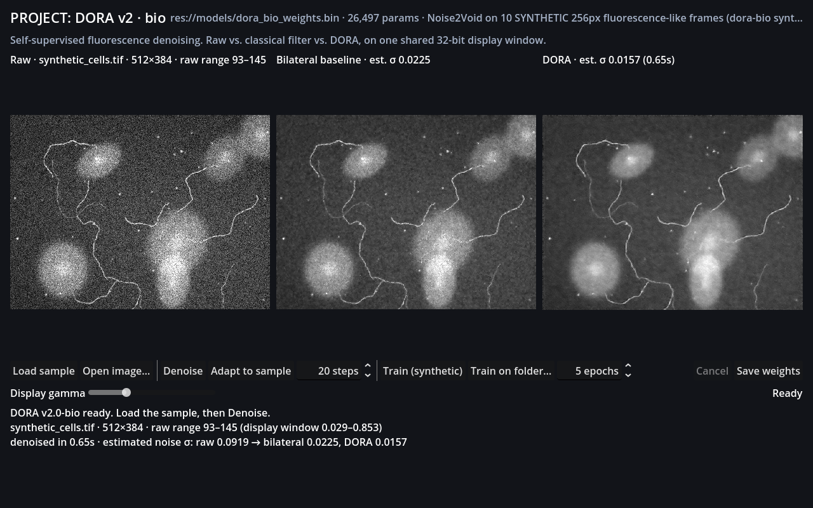

# DORA v2.0-bio

**Self-supervised fluorescence-microscopy denoising, built from scratch in C# and shown in Godot 4.5.**

This folder is a ground-up rebuild of Project DORA (the v1 MNIST digit app at the repo root, which is
left untouched). DORA v2 learns to remove photon shot noise and camera noise from microscope images.
With **Noise2Void** it learns from the noisy images alone, with no clean ground truth, and it can keep
adapting to the sample on screen. Like v1, every line of the ML is readable code with no ML framework.



*Real render of the Godot app (Xvfb + Mesa). The sample image is **synthetic**: see the honesty notes below.*

## What's verified

All numbers come from this repo, run on a 4-core cloud VM with no GPU.

| Check | Result |
|---|---|
| Core unit tests (`dotnet test`) | 488 passing in ~6 s, including finite-difference gradient checks for both architectures (mutation-tested) |
| Brick gates (`./bricks.sh`) | all 40 green (gates 11–15, 21, 25, 27, 29, 30–35, 37 and 38 with the FMD data, benchmark downloads and experiment weights present); documentation of every public member is enforced by the build |
| Gates can fail (`./bricks.sh --self-test`) | one planted bug per gate 0–7 and 11–39 (two for gates 0, 28, 29, 31, 33, 35 and 36, three for 34 and 39, four for 37 and 38), all 54 caught (after a clean control copy passes) |
| CI (GitHub Actions) | all gates incl. headless Godot, on PRs into `main`, pushes to `main` and manual runs (docs-only changes skipped): [run #1](https://github.com/Andraszao/project-dora-ml/actions/runs/45617118232) green in 150 s of runner time, 0 billable minutes (public repo) |
| Codecs vs. independent encoders | TIFF/PNG fixtures written by Pillow, ImageMagick and libtiff decode exactly |
| Tiled vs. whole-image inference | identical (≤1e-5) for ragged tiles, tiles smaller than the receptive field, etc. |
| Training reproducibility | two runs with the same seed produce bit-identical weights |
| Bundled model training | Noise2Void on 10 synthetic 256 px frames, reached the 8 dB "mastery" target at epoch 25 in 5 min |
| Held-out evaluation (4 unseen synthetic FOVs) | noisy **20.89 dB / SSIM 0.223** → bilateral **28.43 / 0.677** → DORA **30.21 / 0.809** |
| **Real microscope data** (FMD, 48 held-out images, raw noise level; [details](docs/RESULTS.md)) | noisy **27.22 dB / 0.543** → bilateral **30.22 / 0.752** → DORA supervised **33.75 / 0.880**, or **34.73 / 0.907** with `--arch unet`. Without ground truth: the Noise2Void default, routed by the noise check since Q20, **33.24 / 0.862** (P3's routed pair 32.97 / 0.844, plain Noise2Void 31.68 / 0.774); the bundled synthetic model 32.15 / 0.818 |
| U-Net vs dilated network (same budget) | supervised +0.98 dB, Noise2Void −0.47 dB, 1.36× slower; the dilated network stays the default by the rule set before measuring |
| Tiled vs. whole-image U-Net inference | identical (≤1e-5), with tiles on the 2^depth grid |
| Correlated-noise check (no ground truth) | same verdict as the ground-truth measurement on all 48 FMD test images; flags exactly the 228 widefield images among 912 training images |
| Noise-model calibration (one image) | synthetic: gain within 5.1%, variance curve within 6.8%; real FMD: reliable on widefield only ([details](docs/RESULTS.md#variance-stabilization-and-calibration-bricks-1617)) |
| Train/test leakage on FMD | `dora-bio fmd-check`: every test image is FOV 19 pixel for pixel, and FOV 19 never enters training |
| Godot 4.5.1 .NET smoke test (headless) | loads model and sample, denoises off-thread, adapts, stays responsive; exit code 0 |
| Speed (`dora-bio bench`, 4 cores, no GPU) | 512×512 frame in about **0.21–0.30 s** (dilated) / 0.28–0.36 s (U-Net) on a noisy shared machine; one training step (batch 16 at 64 px) 0.11–0.15 s. The register-blocked kernels are 2.1–2.5× (denoise) and 1.5–2.2× (training) faster than the original ones, and bit-identical to them. On AVX-512 CPUs, 512-bit kernels add 1.3–1.6× (brick 36), still bit-identical |
| Where the time goes (`dora-bio bench --roofline`) | inference is 97% of a stack run; every convolution is compute-bound (34–75 FLOPs per byte, 1–5% of cache bandwidth); the 512-bit forward kernel runs at about 77% of this CPU's peak for separate multiply and add ([details](docs/RESULTS.md#systems-s1--s2-brick-36-where-the-time-goes-and-512-bit-kernels)) |
| Noise-conditioned U-Net (quality pass Q13, three seeds) | measured, not adopted: 0.19 dB worse at raw on average than the plain all-level U-Net, though it does use its noise input. The first seed spread: 0.29 dB at raw, so single-run differences under ~0.3 dB are noise ([details](docs/RESULTS.md#quality-pass-q13-telling-the-network-how-noisy-each-image-is)) |
| **Self-supervised scoreboard** (brick 38; DORA's routed Noise2Void default against CAREamics 0.3.5 Noise2Void and N2V2, same CPU budget; [details](docs/RESULTS.md#the-self-supervised-scoreboard-brick-38)) | within 0.3 dB of the better CAREamics variant on all five sets with references: **FMD 33.24 vs 31.48 dB** (widefield 31.76 vs 27.20), MDC25 Tribolium 18.38 vs 18.26, BioSR+ CCPs 28.82 vs 28.95, MreB 26.80 vs 27.04, nucleoid 34.42 vs 34.70; one seed, so the small gaps are within run-to-run spread. On Tribolium the noise check routes every slice to the structured network, and `noise-residual` shows why: the noise correlates 0.75 between neighbouring rows ([diagnostic](docs/RESULTS.md#after-brick-38-why-the-noise-check-flags-every-tribolium-slice-post-hoc-diagnostic)); the unrouted U-Net scores no better than the noisy input |
| Time-lapses (brick 39, synthetic only so far) | `train --mode n2n` (Noise2Noise from neighbouring frames) and `train --frames 3` (spatiotemporal blind spot); on a still synthetic scene both beat single-frame Noise2Void, and Noise2Noise loses 3 dB once the scene drifts 4 px per frame. Not yet measured on real time-lapses (brick 40) |
| **Against CARE and Noise2Void** (CAREamics 0.3.5, the library behind the napari plugins; three public DeepBacs and ZeroCostDL4Mic sets; same CPU, same budget, CARE's scoring; [details](docs/RESULTS.md#quality-pass-q18-dora-against-care-and-noise2void-on-public-data)) | **with ground truth, DORA's U-Net matches CARE** (27.65 vs 27.58 dB mean, ahead on each set); **without it, DORA's default Noise2Void is behind** (26.28 vs 27.00, about 1 dB on the two sets where Noise2Void works). On the third set, neither Noise2Void helps, and DORA's noise check flags the correlated noise that explains it |
| Self-supervised recipe (quality pass Q12; [details](docs/RESULTS.md#quality-pass-q12-closing-the-self-supervised-gap)) | chosen on validation images: a 118k-parameter U-Net trained by Noise2Void closes 60% of the gap to CAREamics on the public sets (26.70 vs 26.28 dB; CAREamics 27.00) and keeps intensity ratios (MreB slope 0.93 vs 0.75). Not the default yet: on FMD it loses 0.47 dB (`--arch unet --mode n2v` to try it) |
| When Noise2Void should stop (quality pass Q2; [details](docs/RESULTS.md#quality-pass-q2-when-a-noise2void-u-net-should-stop)) | keeping the last of 30 epochs, with no ground truth in the choice, takes the U-Net to 26.84 dB on the public sets (CAREamics 27.00) and MreB slope 0.96 (CAREamics 0.86). Not adopted: on FMD it missed the pre-registered guard by 0.0006 dB, because longer training also learns widefield's pixel-correlated noise (widefield 27.98 → 26.29 dB); routing those images to a structured-blind-spot model is the next pass (`--arch unet --mode n2v --select loss --patience 0 --keep last` to try it) |
| The U-Net with routing (quality pass Q19 + Q20; [details](docs/RESULTS.md#quality-pass-q19-the-u-net-with-routing)) | images the noise check calls independent go to the U-Net (Q2's rule, no ground truth), correlated ones to P3's structured-blind-spot network: **33.24 dB on FMD without any ground truth**, DORA's best self-supervised result (supervised: 33.75), with every microscope type at or above P3's routed pair. Missed only CARE 2D's floor (19.12 against 19.20); the owner then dropped that floor, disclosed as a post-hoc decision (Q20), and **`train --mode n2v` now routes by default** (a mixed set gives `w.bin` and `w.correlated.bin`; denoise with `--weights-correlated`). `--route off` trains one network |
| **Fidelity: what scientists measure** (`dora-bio fidelity`; [details](docs/RESULTS.md#fidelity-what-scientists-measure-brick-32)) | whether intensity ratios between regions survive denoising (slope 1.00) and whether spots are invented or erased. DORA's supervised U-Net keeps ratios on FMD (slope 1.02, 3.9% error) and 72% of its spots are real (raw frames: 14%); DORA's Noise2Void compresses contrast (slope 0.75 on MreB, against CAREamics' 0.86) |
| Public paired datasets (`tools/fetch_ext.sh`, `dora-bio ext-check`) | DeepBacs (*E. coli* MreB, nucleoid; *B. subtilis*) and the ZeroCostDL4Mic CARE 2D example, pinned by SHA-256; DORA's reader opens all 194 TIFFs, including Micro-Manager OME-TIFF stacks |
| Benchmark data (`tools/ext_manifest.json`, `dora-bio stack-check`) | 17 datasets in one manifest (2024/2025 AI4Life challenge sets, BioSR+, DeepCAD-RT, plus the above; 58 GB), each with its Zenodo size and MD5, a SHA-256 pinned from the first verified download, its licence and whether it may train a shipped model; [`ATTRIBUTIONS.md`](ATTRIBUTIONS.md) is generated from it. Stacks are read plane by plane by axis (time, z, channel, field of view): ImageJ and tifffile metadata, **BigTIFF** and **MRC**, checked against files written by tifffile and mrcfile. The downloaded sets match their published counts (see PATHWAY.md, brick 34) |
| Stacks and folders (`dora-bio denoise --in STACK.tif` or a folder) | streamed one frame at a time: every page comes out bit for bit as the same frame denoised alone, and peak memory stays flat in the stack's length (512² frames: 182 MB for 3 pages, 265 MB for 160, at 0.22 s per page) |
| Performance guard (gate 24) | budgets in `tools/ci/perf_budget.json`, plus a check that the blocked kernels stay ≥ 1.5× (denoise) and ≥ 1.25× (training step) faster than the reference kernels, timed interleaved in the same run so it holds on any machine |

## Quick start

**Run the app.** Requires the **.NET build** of Godot 4.5.x and the .NET 8 SDK.

```bash
cd dora-bio/godot
dotnet build            # or press Build in the Godot editor
godot --path .          # or open dora-bio/godot/project.godot in the editor and press F5
```

Click **Load sample**, then **Denoise**. **Adapt to sample** runs self-supervised fine-tuning on the image on
screen. **Train (synthetic)** generates data in memory and keeps training. **Train on folder…** trains on your
own data. **Save weights** writes `user://dora_bio_weights.bin`.

**Build brick by brick.** The project is a stack of 11 bricks (scaffold → nn → data → io → inference → training →
cli → godot-build → godot-smoke → ci-core → ci-godot). Each has a gate that must pass before the next is trusted,
and CI runs them all on PRs into `main`:

```bash
cd dora-bio
./bricks.sh --list       # what each gate checks
./bricks.sh              # run every gate in order, stop at the first red one
./bricks.sh --only 5     # iterate on a single brick
./bricks.sh --self-test  # prove the gates can fail: one planted bug per gate, each must turn red
```

**Headless (CLI).** Works anywhere .NET 8 runs, with no Godot needed:

```bash
cd dora-bio
dotnet test DoraBio.sln
alias dora-bio="dotnet run --project tools/DoraBio.Cli -c Release --"
dora-bio synth   --out data/synth --count 10 --size 256
dora-bio train   --data data/synth --out runs/w.bin --mode n2v --journey runs/journey.json
dora-bio eval    --weights runs/w.bin --data data/heldout
dora-bio denoise --weights godot/models/dora_bio_weights.bin --in my_image.tif --out clean.tif --baseline bilateral.tif
dora-bio denoise --weights godot/models/dora_bio_weights.bin --in my_stack.tif --out clean_stack.tif   # every page
dora-bio denoise --weights godot/models/dora_bio_weights.bin --in my_folder/ --out denoised/          # every image
```

**Your own data.** Use TIFF (8/16/32-bit) or PNG. A training folder can be:
- `noisy/` with optional `clean/`, matched by file name. Supervised training if every image has a clean match, otherwise Noise2Void.
- The [FMD dataset](docs/RESULTS.md#data) (`tools/fetch_fmd.sh` downloads it): the dataset root, one category, or `test_mix`. FMD's test FOV (19) is never used for training.
- A flat folder of noisy images (Noise2Void only).

**Real microscope data (FMD).** About 9 GB, downloaded and checksum-verified into the gitignored `data/fmd/`:

```bash
tools/fetch_fmd.sh                                   # needs drive.usercontent.google.com
dora-bio fmd-check --root data/fmd                   # structure, and no train/test leakage
dora-bio train     --data data/fmd --out runs/fmd.bin --mode supervised --seed 2026
dora-bio fmd-eval  --weights runs/fmd.bin --root data/fmd    # held-out test_mix, per microscope type
tools/experiments/p2_fmd.sh                          # every run in docs/RESULTS.md (~45 min CPU)
```

## How it works

```
Godot (UI, main thread)                          DoraBio.Core (pure net8.0, no Godot, no NuGet)
┌───────────────────────────────┐   calls      ┌───────────────────────────────────────────────┐
│ Main.tscn + MicroscopyViewport│ ───────────▶ │ ImageLoader (TIFF/PNG) → Normalization (float) │
│   .gd (widgets only)          │              │ DenoisingNet: 7× dilated 3×3 conv, residual    │
│ contrast_stretch.gdshader     │              │ TiledInference (parallel, exact)               │
│   (Rf float textures, shared  │   signals    │ Trainer: mini-batch Adam, N2V blind spots,     │
│    window, keep-aspect)       │ ◀─────────── │   FOV-held-out validation, PSNR/SSIM, LR decay │
│ DoraBioBridge.cs ─ Task.Run ─▶│ (CallDeferred│ OnlineAdapter (persistent Adam), JourneyLog    │
└───────────────────────────────┘  to main)    └───────────────────────────────────────────────┘
```

- **Model:** a DnCNN-style residual CNN. It predicts the noise, and the output is `input − noise`. Dilations
  1-2-4-8-4-2-1 give a 45 px receptive field with 26,497 parameters, stored in a 106 KB binary file with a CRC.
- **Noise2Void:** about 2% of pixels per patch are swapped for a random neighbor's value, and the loss is computed
  only at those pixels. The network can't copy a pixel's own noise, so it learns the signal.
- **Progressive targets (DORA's milestone loop):** targets are PSNR *gains* over the noisy input (+2, +4, +6,
  +8 dB). Two hits in a row raise the target, and holding the last one is mastery. Unlike v1, plateaus
  *lower* the learning rate (×0.85), and the best weights are kept.
- **Journey log:** `user://dora_bio_journey.json` gets one session per training run, with every epoch recorded.

## v1 problems fixed in v2

| v1 (GDScript, `02dd999`) | v2 |
|---|---|
| "Batch size" only changed logging; updates were per sample | real mini-batches, with per-sample gradients summed in a fixed order |
| Hidden-layer backprop used already-updated output weights | full backward pass before one optimizer step; verified with finite differences |
| Fresh Adam on every feedback click, so updates were `lr·sign(g)` | `OnlineAdapter` keeps Adam state for as long as the model is loaded |
| Learning rate *multiplied up* on success | learning rate only decays on plateaus; best weights restored and checkpointed |
| 98% max target was unreachable | the maximum is the last target, and holding it is mastery |
| Training accuracy reported as if it were validation | validation held out by field of view; PSNR/SSIM against clean data |
| Dataset loaded and augmented on every launch | only weights load at startup; data loads when training starts |
| Journey log: empty epochs, duplicate sessions | session opens only when training starts, every epoch saved, ends `completed` or `failed` |
| 8-bit RGBA canvas, non-square panel squash | float32 end to end, `Image.Format.Rf`, keep-aspect display |
| Synchronous training froze the window | every heavy job runs on the thread pool, with cancel |
| Fallback path skipped signal wiring; `get_node("../…")` paths | `@export` node references; one bridge class |

## Changes from the original v2 proposal

The plan this rebuild started from had a few errors. Where the build differs from it:

- **No HDF5 / PureHDF.** The FMD dataset ships as PNG, not `.h5`, and the core takes no dependencies.
  HDF5 input gets a clear "not supported" error. Export frames to TIFF, or add a reader later in a separate project.
- **Signal names from GDScript are PascalCase** (`bridge.DenoiseFinished`), not `inference_finished`.
- **Starter-code bugs fixed:** `SubtractResidual` clamped only its scalar tail (outputs are now never clamped).
  The blind-spot mask used a fixed seed, so every step got the same mask (now a fresh mask each step).
  `Conv2D` had no backward pass (now forward and backward, gradient-checked).
- **Residual dilated CNN instead of a U-Net** for this first version: much less code to verify, an exact tiling
  guarantee, and a 45 px receptive field. A U-Net is a reasonable next step.
- **Progressive targets on PSNR gain**, not fixed 24/26/28/30 dB, because absolute PSNR depends mostly on the
  noise level, so fixed targets wouldn't carry over between datasets.

## Roadmap

[`PATHWAY.md`](PATHWAY.md) lays out phases P0–P10: the foundation (P0), CI (P1), validation on real FMD data (P2),
noise-model fidelity (P3: correlated-noise check, structured blind spots, variance stabilization), a U-Net (P4) and
performance (P5: benchmarks, faster bit-identical kernels, time budgets) are done. Stacks and batch (P6) are under way
(multi-page TIFF writing and streamed stack/folder denoising are in), alternating with pre-registered quality passes. Then
analysis tools, model management, more formats, and a release. Each phase is a set of gated bricks.

## Honesty notes and limitations

- **Everything shipped here is synthetic.** `godot/samples/synthetic_cells.tif` and the bundled weights come from
  `SyntheticFluorescence` (procedural cells, filaments and puncta with Poisson–Gaussian noise). Weights trained on
  FMD aren't shipped (the data is CC BY-SA 4.0); `tools/experiments/p2_fmd.sh` retrains them.
- **Real-data performance is measured on one public dataset (FMD), with one seed per configuration and a small
  CPU-trained network** ([RESULTS.md](docs/RESULTS.md)). It is not a claim about your microscope: check with
  `dora-bio eval` on held-out FOVs that have ground truth.
- **Plain Noise2Void fails on correlated noise, and real cameras produce it.** On FMD's widefield images
  neighbouring pixels' noise is 0.6 correlated, and plain Noise2Void scores 27.97 dB there against 33.02 for
  supervised training. DORA now detects this from the image alone (`dora-bio diagnose`, and on every image the app
  loads). Structured blind spots (`--struct auto`) recover most of the gap on noisy input (31.76 dB), but they are
  opt-in: they lose on clean input, and mixed data needs two networks
  ([RESULTS.md](docs/RESULTS.md#p3-correlated-noise-and-structured-blind-spots)). **Adapt to sample** uses them
  automatically on flagged images. If you have averaged frames as ground truth, supervised training is still best.
- **Variance stabilization (`--vst`) is opt-in and lost on FMD.** It works when the noise model is right, but
  estimating that model from one dim 8-bit confocal frame isn't reliable, and overall Noise2Void scored 0.25–0.28 dB
  lower with it. A model trained with `--vst` must also be applied with `--vst`.
- **DORA can make clean images worse.** On FMD's 16-frame averages, every default model scores below the
  unprocessed input (the bundled model by 4.2 dB). It has no notion of "this image is already clean". A supervised
  U-Net trained on all noise levels (`--arch unet --fmd-levels raw,avg2,avg4,avg8,avg16`) is the exception, slightly
  above the untouched image, but it costs 0.47 dB on the noisiest input, so it isn't a default
  ([quality pass Q1](docs/RESULTS.md#quality-pass-q1-the-best-supervised-recipe)).
- **Self-supervised DORA is behind the standard tool.** On public data where Noise2Void works, CAREamics' Noise2Void
  scores about 1 dB higher than DORA's default (a 26k-parameter network against 334k), and DORA's output distorts
  intensity ratios more (on MreB, ratios measured on it are less accurate than on the raw frame). With ground truth
  DORA is at parity with CARE. Don't quantify intensities on DORA's Noise2Void output yet; closing this gap comes
  before asking labs to try DORA.
- The "estimated noise σ" in the UI is Immerkær's white-noise estimate: a rough image-wide figure, not calibrated.
- C# Godot projects **cannot export to the web** (Godot 4.5), so v2 targets desktop and mobile only.
- CPU only. That's fine for 512² frames and small models: a stack takes about 0.22 s per 512² page, in bounded memory.
  3D volumes (denoising across z, not page by page) would need GPU work.

## Layout

See [`CLAUDE.md`](CLAUDE.md) for the file map, the architecture rules, and the Godot⇄C# gotchas, written for
AI coding sessions but useful for humans too.
